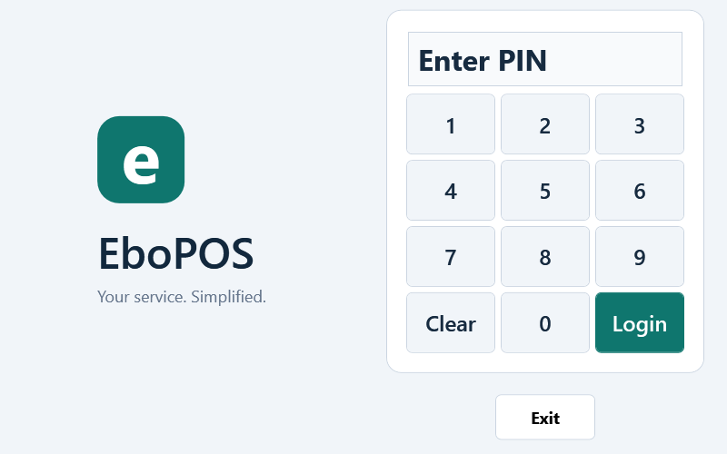
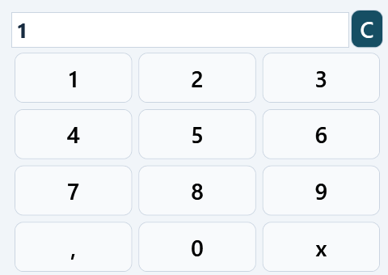
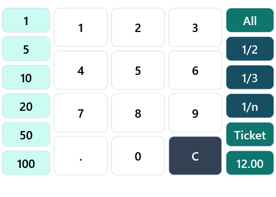
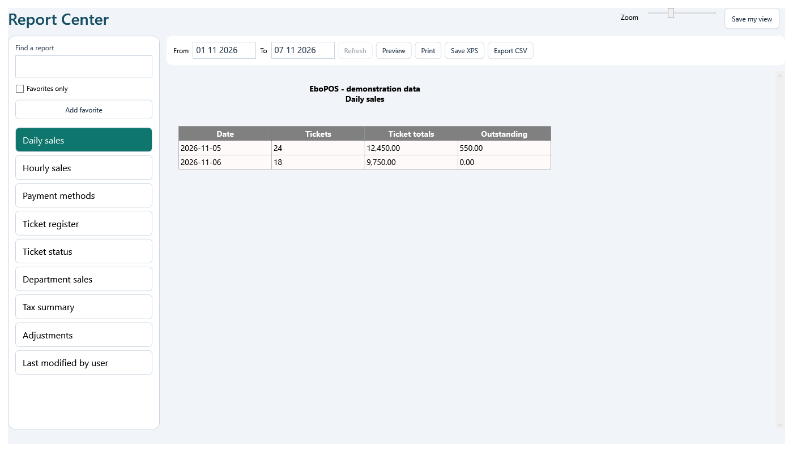
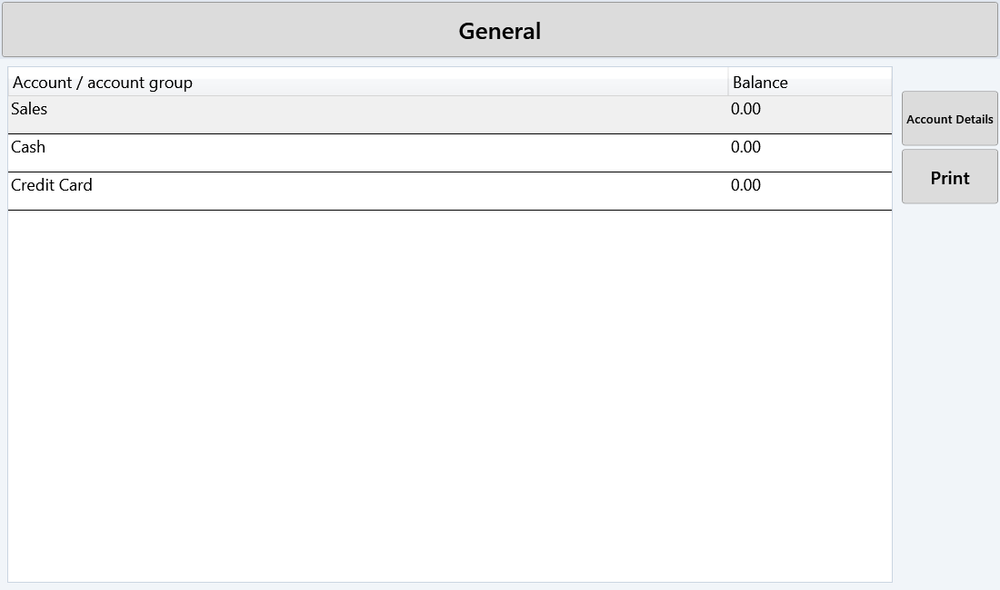
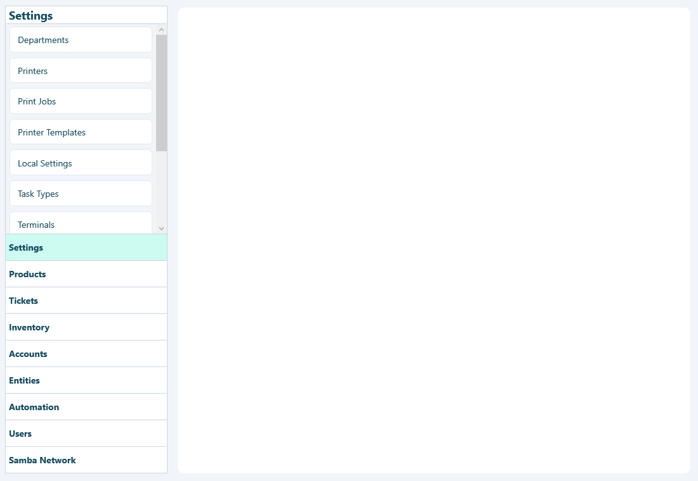

# EboPOS Desktop

A native Windows restaurant POS frontend based on SambaPOS 3. EboPOS refreshes the desktop interface while retaining the existing ordering, payment, account, printing and database workflows.

## Screenshots

These are native WPF renders of the implemented controls with sample content. They illustrate the interface without exposing a restaurant database, credentials or customer records.

### Sign in



### Medium ordering keypad



### Payment keypad



## Features

- EboPOS branding and an **e** window/executable icon.
- Native Windows WPF application; no browser or web server is needed for the POS interface.
- Teal, slate and light backgrounds with rounded touch controls.
- Medium ordering keypad with bounded dimensions, including after menu refreshes.
- Refreshed table, ordering and payment layouts.
- Scrollable payment-method cards, so additional configured methods remain reachable.
- Readable payment labels with configured sizes bounded to 18–30 points; zero uses 22 points. Stored settings are unchanged.
- Existing payment commands, parameters, account/currency filtering and permission checks retained.
- Samba Market navigation shortcut removed.
- No custom activation-key gate.

## Requirements

- Windows with .NET Framework 4.x and its MSBuild/C# tools. The original projects target .NET Framework 4.0, including Client Profile projects.
- Internet access for the first scripted build to download Microsoft's .NET 4.0 reference assemblies from NuGet.
- A Windows development environment that permits the build tools and locally compiled application to run.
- The database provider and connection configuration required by your installation. Existing SQL Server installations are not provisioned by this repository.

This is a legacy .NET Framework application. It is not a .NET Core/modern `dotnet run` project.

## Build

Extract or clone the repository, open PowerShell in the repository root and run:

```powershell
.\Build\Build-Desktop.ps1
```

The build script uses the installed .NET Framework MSBuild, downloads reference assemblies into `Build/.cache`, builds Release/x86, and suppresses the original installer-copy post-build commands. `Build/Desktop.targets` generates language resource assemblies using the C# compiler instead of the missing legacy `AL.exe` tool.

The caller-ID project references the supplied `stdole` interop assembly instead of regenerating it using legacy SDK tooling. Hardware-specific caller-ID functionality still requires its original device/runtime dependencies.

You can also open `SambaPos.sln` in an appropriately configured Windows Visual Studio environment. The script is the documented build path for the legacy dependencies handled here.

## Run

After a successful build, run:

```powershell
.\Samba.Presentation\bin\Release\Samba.Presentation.exe
```

Keep **the complete Release folder** together, including DLLs, language folders, configuration and Imports. You can copy that folder to drive E: and launch the EXE there. The internal executable name remains `Samba.Presentation.exe`; the displayed product branding is EboPOS.

Close other running copies before launching. No custom activation key is required; normal POS user/PIN authentication remains in place.

The original data/settings locations remain in use. Moving the executable to E: does not move or migrate the existing database. Back up your existing installation and data before upgrading. This repository contains no production database or customer credentials.

## Add product pictures

1. Open **Manage → Products → Screen Menus**.
2. Open the menu, select a category and choose **Edit Product Properties**.
3. Set the product's **Image Path** to a JPG or PNG file.
4. Save and reopen the POS screen.

Keep pictures in a permanent folder accessible to every terminal that uses them. Category pictures are also supported by the existing image-path settings.

## Configure JazzCash, Easypaisa or other payment methods

1. Open **Manage → Tickets → Payment Types**.
2. Create/open the payment method and select its appropriate **Account Transaction Type** and **Account**.
3. In **Mappings**, add a mapping for the intended role, department, ticket type and any other available scope fields.
4. Save, then reopen the payment screen or restart the app to refresh cached configuration.

The original system deliberately hides payment types without a matching mapping. It also applies currency/account filters. A visible method can remain disabled until an amount is entered and its original accounting rules allow payment.

The screen supports additional payment methods dynamically; they are not hardcoded into the layout. A JazzCash/Easypaisa button records the configured tender type. It does **not** by itself connect to a wallet API or verify that money arrived. Configure separate wallet accounts if your accounting requires separate reconciliation.

## Pakistan tax reporting

FBR, PRA, SRB, KPRA and BRA integrations are **not implemented** in this repository. No government API tokens, tax rates or production credentials are included. Such integration requires the applicable authority's current onboarding, specifications, account configuration and testing; the appropriate authority depends on the business and jurisdiction.

## Validation

- Release/x86 compilation completed successfully on the development machine.
- Login and keypad controls were rendered using native WPF.
- Compiled payment controls were checked with JazzCash, Easypaisa, ten additional sample methods and Close.
- Checks covered collection refresh, overflow scrolling, configured/default font behavior, command and payment-type parameter preservation, and original `CanExecute` restrictions.
- Payment-module C# business logic was verified unchanged from the supplied upstream archive.

`Build/PaymentLayoutTests.cs` contains the WPF payment-layout checks. They use dummy payment handlers and do not post real sales or payments. Full restaurant workflows, payment gateways, hardware, printing and production database compatibility have not been comprehensively tested.

## Project layout

| Path | Purpose |
| --- | --- |
| `Samba.Presentation` | Desktop application, shell and shared appearance resources |
| `Samba.Modules.PosModule` | Ordering and menu/keypad screens |
| `Samba.Modules.PaymentModule` | Payment views and original payment behavior |
| `Samba.Modules.EntityModule` | Table/entity screens |
| `Samba.Presentation.Controls` | Shared controls and presentation converters |
| `Build` | Desktop build helpers and layout checks |
| `docs/screenshots` | Screenshots used in this README |

## Attribution and license

EboPOS is a modified version of **SambaPOS 3**, originally copyright Emre EREN and its contributors. Existing source notices are retained. The supplied upstream license notice specifies **GNU GPL version 3 or later**; see [LICENSE](LICENSE) and the [full GNU GPL v3 text](https://www.gnu.org/licenses/gpl-3.0.html).

Bundled third-party libraries retain their own licenses and notices. Rebranding the frontend does not replace those licenses. The separately referenced SambaWebReports PHP project is not included in this desktop application.

## Report Center and Accounts update

Report Center retains the nine original reports and adds nine operational views:
daily sales, hourly sales, payment methods, ticket register, ticket status,
department sales, tax summary, signed adjustments, and last-modified-user summaries.
All eighteen reports retain the original report-access and date-change permissions.

Search for a report, use its period/date filters and Refresh. Add favorites, filter
to favorites and choose a zoom level. **Save my view** stores favorites and zoom
separately for each POS user within the current Windows profile. Preferences live
in `%LOCALAPPDATA%\EboPOS\ReportPreferences`, outside the POS database. Search is
session-only. This is a report catalog with saved preferences, not an arbitrary
SQL query or drag-and-drop report-template designer.



**Preview** opens a cloned, read-only paged copy of the generated report. The
Preview, Print, Save XPS and Export CSV actions require a generated document.
CSV export writes rendered table cells with escaping and spreadsheet-formula
protection for labels. Print can use installed Windows printers, including a PDF
printer if one is available. Native PDF generation is not included.

Operational report scope deliberately follows the existing ticket selection:
tickets are selected by last-payment date for the chosen period; daily/hourly
buckets use ticket creation time. Open tickets are included. Payment-method
summaries show gross payments on selected tickets before change/refunds, rather
than a standalone cash-flow reconciliation. Department summaries show department
IDs. The user summary identifies the last modifying user, not necessarily the
original cashier. The tax summary uses existing ticket-tax calculations and is
not a government filing/integration. Monetary totals are not converted across
currencies. Validate accounting reports against your ledger before production use.

Accounts now displays numeric zero balances instead of dashes. Select an
account-type total and choose **Account Details** to browse its accounts, then
select an individual account for its transaction history. Selecting the group
button returns to totals. Drill-down keeps the screen's date scope and does not
change saved account-screen settings or post transactions. The table supports
column sorting, resizing and reordering during the session.



The reporting month-length bug was corrected to use the actual year, including
leap years. `Build/Tests/ReportCenterTests.cs` exercises all operational modes,
printable-document creation, empty data, totals, CSV, preview cloning/gating,
profile serialization/separation and account-type drill-down with dummy services.
No live database is included in the repository or used by these tests.

### Payment-method labels and Settings theme

Payment-method reports now resolve the configured payment-type ID, rather than
the payment record's account-name label. JazzCash and Easypaisa remain distinct
from Cash even when they share the Cash account. Configured mapped methods with
no activity display zero rows; historical/deleted types retain their recorded
labels and amounts. This change does not relabel or modify stored transactions.
Settings navigation now uses flat teal/mint category selections and clearer
command buttons while retaining its existing commands, tabs and editor bindings.


